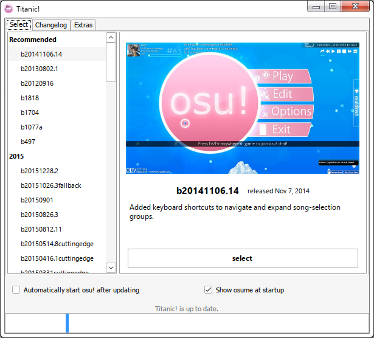
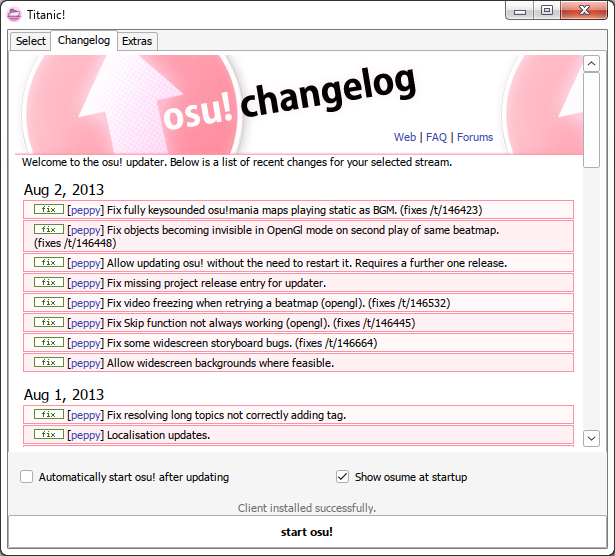
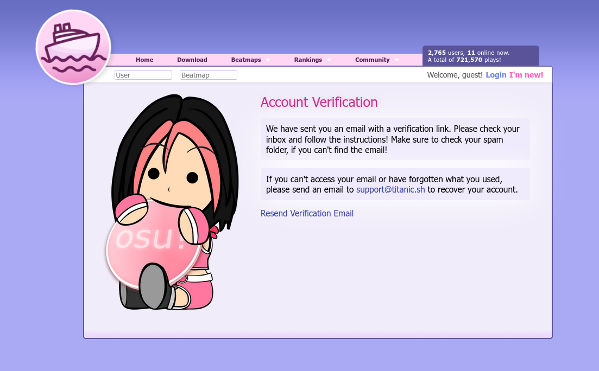

# Installation

[TOC]

To begin playing on Titanic!, being by downloading the [[Launcher]], found on the [download page](https://osu.titanic.sh/download).
The button you will find there should be easy to find. Click it, and it will start downloading the launcher.

Place the *.exe* you downloaded in an **empty folder** and launch it. If you experience difficulties with getting the launcher to launch, try to use the *fallback* variant of the launcher.

You will be prompted by a collection of versions you can download.  
Choose one, click "**select**", wait for the download to finish, and click **start osu!**

Whenever you want to play the game now, you should use the *.exe* of the launcher and **not** the original osu!.exe. Using the original .exe won't connect you to Titanic's servers.

If you are not able to get the game to work, and you don't know what to do, fear not! We will resolve your issue in the [Support](https://osu.titanic.sh/forum/7) forum. Clearly state your situation, and we will try to help as much as we can.

## Registering an account

To start playing online, you need an account, for obvious reasons. Head on over to the [registration page](https://osu.titanic.sh/account/register) by clicking on "I'm New!". **Remember you are only allowed to have *ONE* account EVER!**

After you create your account you will be prompted to verify your email.  

You should receive an email containing an activation link, which you may follow to activate your account.

<!-- TODO: Re-add linux & macos installation instructions (hopefully not outdated this time) -->
