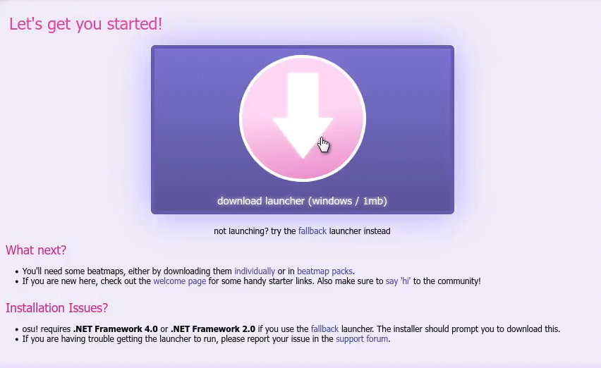
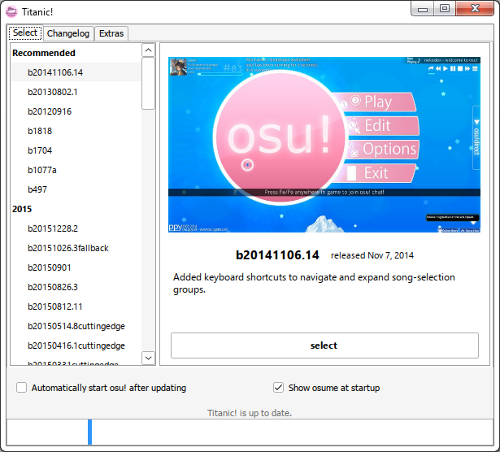
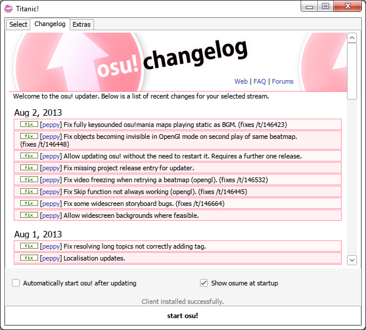
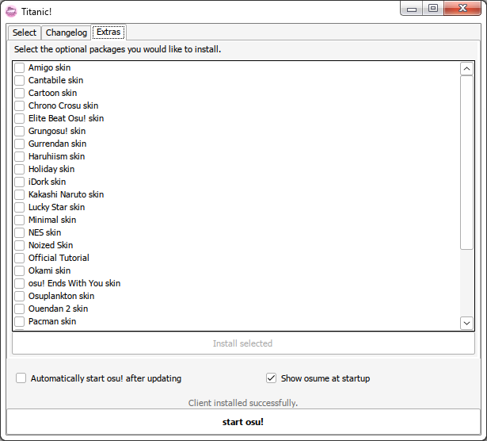

# Titanic! Launcher

[TOC]

The Titanic! Launcher (formerly known as the "Titanic! Patcher") is now the standard way of playing on Titanic.  
Previously, users would download a custom patched build of the game. However, with the release of the launcher, you can now use the original, untouched game files.

## Installation Instructions

You can find the latest release of the launcher on the [downloads page](https://osu.titanic.sh/download). Click the conveniently huge placed button and it will redirect you to the download.

<!-- dunno whether to include this
As an alternative: the launcher is fully open-source and also available for download on the GitHub [Release Page](https://github.com/osuTitanic/hook/releases).
-->

Once downloaded, place the *.exe* file in an **empty folder** and launch it. Use the *fallback* variant of the launcher if you experience issues with the regular one.

You will be prompted by a collection of versions you can download.  
Choose one, click "**select**", wait for the download to finish, and **start osu!**

## "Extra" Content

This launcher is directly inspired by "[osume](https://osu.ppy.sh/community/forums/topics/4?n=1)" (aka. pUpdater), which was the primary way users would update their game back in the day, until it was replaced by a built-in updater in 2014. osume had optional content that you could download alongside your installation of the game, referred to as "Extra".

Titanic has revived this functionality, and you can find it in the same place as osume once had it.

Simply tick the things you would like to install, and click "**Install selected**".

## Skipping the Launcher

If you, for any reason, want to skip straight to the game, you have two options:

- Uncheck "Show launcher at startup"
- Create a custom shortcut

The first one should be self-explanatory. Simply remove the tick from the checkbox that says "Show launcher at startup". Once you restart the launcher, it will no longer show the "osume" interface, and directly launch the game. To re-enable the launcher, remove your `Titanic!.cfg` file.

Similar to how you might use `-devserver` to play on modern osu! private servers, you can create a shortcut on your launcher executable, and append `-go` to the "Target". Note that this method will *not* automatically check for new updates anymore.

## Open Source

The launcher and patcher components are fully open-source. If you are skeptical, or are just curious on how the launcher works behind the scenes, check out the [GitHub Repository](https://github.com/osuTitanic/hook).
